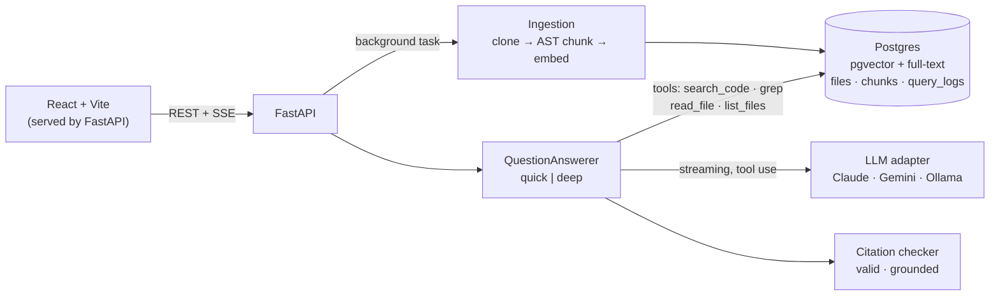

# Ask Repo

Ask questions about any public Python repository on GitHub and get answers that
**cite the exact file and lines**, with every citation checked against what the
model actually read.

<!-- Add screenshots: docs/screenshots/answer.png, docs/screenshots/source-viewer.png -->

## Quick start

Requires Docker and one of: an [Anthropic API key](https://console.anthropic.com/),
a [Gemini API key](https://aistudio.google.com/apikey), or [Ollama](https://ollama.com)
running locally. See [LLM providers](#llm-providers). No Docker? See
[Running without Docker](#running-without-docker).

```bash
cp .env.example .env        # set LLM_PROVIDER and that provider's key
docker compose up --build   # first build downloads the embedding model (~130 MB)
```

Open http://localhost:8000, click **Try it with encode/starlette**, and ask a question
once indexing finishes (about a minute on CPU).

### Local development

```bash
make setup       # install backend and frontend dependencies (once)
make db          # Postgres + pgvector: uses one already running locally, else starts it in Docker
make dev         # API on :8000 (reload) and Vite on :5173
make test        # backend tests against the real database
make lint        # ruff, mypy, tsc
make eval        # retrieval eval, no API key needed
```

Backend: Python 3.12 with [uv](https://docs.astral.sh/uv/). Frontend: Node 22.
One `.env` at the repo root is used both by Docker Compose and by the backend run
directly (`backend/.env`, if present, overrides it).

### Running without Docker

Docker only provides Postgres. Everything else already runs natively, so without Docker
you need Postgres 16 with the [pgvector](https://github.com/pgvector/pgvector) extension,
plus Python 3.12+ with uv, Node 22, and git (used to clone the repos you index).

1. Install Postgres and pgvector.

   macOS (Homebrew):
   ```bash
   brew install postgresql@16 pgvector
   ```
   ```bash
   brew services start postgresql@16
   ```

   Ubuntu / Debian:
   ```bash
   sudo apt install postgresql-16 postgresql-16-pgvector
   ```

   Windows: use WSL2 and follow the Ubuntu steps.

2. Create the user and database the app expects by default (on Linux, prefix each with
   `sudo -u postgres`):
   ```bash
   psql postgres -c "CREATE USER askrepo WITH PASSWORD 'askrepo' SUPERUSER;"
   ```
   ```bash
   psql postgres -c "CREATE DATABASE askrepo OWNER askrepo;"
   ```
   `SUPERUSER` lets the app create the `vector` extension and lets the tests create their
   own `askrepo_test` database. That's fine on your machine; don't do it on a shared server.
   To use an existing database instead, set `DATABASE_URL` in `.env`.

3. Configure, install and run:
   ```bash
   cp .env.example .env      # set LLM_PROVIDER and its key
   ```
   ```bash
   make setup
   ```
   ```bash
   make dev
   ```
   Open http://localhost:5173. `make dev` sees Postgres already listening on
   `localhost:5432` and does not try to start Docker. If your Postgres uses another port,
   run `make dev DB_PORT=5433` and set `DATABASE_URL` to match.

Differences from the Docker setup:
- **First indexing is slower.** The embedding model (~130 MB) downloads once into a
  local cache; the Docker image ships with it.
- **Ollama** is reached at `http://localhost:11434` (the default outside Docker).
- **If pgvector is missing**, the app stops at startup with a message saying how to install
  it, rather than failing later.

## What it does

1. **Index**: paste a GitHub URL. The repo is shallow-cloned and Python files are
   split along their syntax tree (functions, methods, class and module outlines).
   Markdown and config files are split by heading or line window. Chunks are embedded
   on CPU and stored in Postgres with a full-text index.
2. **Ask** in one of two modes:
   - **Deep**: an agent with four read-only tools (`search_code`, `grep`, `read_file`,
     `list_files`) explores until it has evidence, then answers. The steps stream live.
   - **Quick**: one hybrid retrieval, one model call. Cheaper and faster.
3. **Verify**: every `[path:Lx-Ly]` citation is checked: does the range exist, and
   was the model actually shown those lines? Unverified citations are flagged amber.
   Clicking a citation opens the source with the lines highlighted.

## LLM providers

Pick one with `LLM_PROVIDER` in `.env`. Indexing and search are the same for all three;
only the model that reads the evidence and writes the answer changes.

| | Claude (default) | Gemini | Ollama (local) |
|---|---|---|---|
| `LLM_PROVIDER` | `anthropic` | `gemini` | `ollama` |
| Credentials | `ANTHROPIC_API_KEY` | `GEMINI_API_KEY` | none |
| Default `LLM_MODEL` | `claude-opus-5-5` | `gemini-2.5-flash` | `qwen3:8b` |
| Streaming, tool use | yes | yes | yes (model must support tools) |
| Prompt caching | explicit breakpoints (see below) | implicit, automatic | n/a (local) |
| Reasoning | adaptive thinking; `LLM_EFFORT` = low / medium / high | model default thinking | model default |
| Safety refusal | automatic fallback to another Claude model, else an error shown | error shown | n/a |
| Cost | see [Cost](#cost-and-caching) | see below | free (your hardware) |

**Claude**: set `ANTHROPIC_API_KEY`. `LLM_MODEL=claude-sonnet-5-5` is about half the cost of Opus.

**Gemini**: set `LLM_PROVIDER=gemini` and `GEMINI_API_KEY`. Google renames and retires
models often; set `LLM_MODEL` to any current Gemini model id with function calling.
If it isn't in the price table, add `PRICE_*` variables or the cost shows as "n/a".

**Ollama**: install Ollama, then:

```bash
ollama pull qwen3:8b       # or llama3.1, mistral-small, … any model tagged "tools"
ollama serve               # if it isn't already running
```

Set `LLM_PROVIDER=ollama`. In Docker the app reaches Ollama on your machine through
`host.docker.internal:11434`. Outside Docker set `OLLAMA_BASE_URL=http://localhost:11434`.
`OLLAMA_NUM_CTX` (default 32768) is sent with every request, because Ollama's default
context window is too small for the system prompt plus tool results. Expect weaker
answers than the hosted models: small models call tools less reliably, so **Quick**
mode often works better locally.

The adapters live in `backend/app/agent/llm/`, one file per provider (about 100 lines
each) behind provider-neutral message types. The agent loop, tools, prompts and
citation checks are shared. Adapters are used instead of a compatibility layer so
each provider keeps what makes it work well: Claude's thinking blocks and cache
breakpoints, Gemini's thought signatures between tool calls, Ollama's context size.
All three are tested offline against canned responses (`tests/test_providers.py`).

## Cost and caching

Every answer's footer shows tokens in and out, the share read from cache, the cost, and
the model that answered. Every question is also logged in `query_logs`.

**Estimated cost per question on Claude Opus 5.5** ($4 input / $20 output per million tokens,
cache reads $0.20, cache writes $5):

| Mode | Model calls | Estimate |
|---|---|---|
| Quick | 1 | ~$0.03–0.05 |
| Deep, before history caching | 3–4 | ~$0.13–0.16 |
| Deep, with history caching | 3–4 | **~$0.10–0.12** |

Indexing and the retrieval eval cost nothing (embeddings run on CPU). The answer eval
(`make eval-answers`, 22 questions, deep) is roughly $2.50–3. Sonnet 5.5 halves all of
these; Ollama is free.

**How history caching works.** In deep mode each agent step resends the whole
conversation so far: system prompt, tools, question, and every earlier tool call and
result. Claude's prompt cache is prefix-based, so the adapter marks two cache breakpoints:

1. **System prompt + tool definitions**: identical for every question on a repo.
2. **The end of the conversation**: on the newest tool result, in deep mode only.

The next step then reads everything before its new tool results from cache at 5% of
the input price, and pays the 1.25× write rate only for what that step added.

Worked example for a typical 4-step answer with ~4k tokens of tool output per step
(system prompt already cached from an earlier question):

| | Uncached input | Cache read | Cache write | Input cost |
|---|---|---|---|---|
| Before | ~24k tokens × $4 | ~12k × $0.20 | ~0 | ~$0.10 |
| After | ~0.1k × $4 | ~24k × $0.20 | ~12k × $5 | ~$0.065 |

That cuts input cost by about a third. Output (~1.5–3k tokens, ~$0.03–0.06) is
unchanged, so the whole question costs about 25% less. Quick mode deliberately does not
cache its conversation: it makes one call, so a cache write would be a 25% surcharge that
is never read back.

These are estimates from token counts. To see real numbers:

```bash
docker compose exec db psql -U askrepo -c "
  select provider, model, mode, count(*) as questions,
         round(avg(cost_usd), 4) as avg_cost,
         round(100.0 * sum(cache_read_tokens)
               / nullif(sum(input_tokens + cache_read_tokens + cache_write_tokens), 0)) as pct_cached
  from query_logs where error is null
  group by 1, 2, 3 order by 1, 2, 3;"
```

In a healthy deep-mode run `pct_cached` should be well above 50%. If it is near zero,
caching is not taking effect. In `query_logs`, `input_tokens` counts **uncached** input
only; cached tokens are in their own columns.

## Architecture



| Path | Responsibility |
|------|----------------|
| `backend/app/ingest/` | `source.py` (URL validation, clone, file filter), `chunker.py` (AST chunking), `pipeline.py` |
| `backend/app/store.py` | All SQL: vector, keyword, hybrid (RRF), grep, file access, query logs |
| `backend/app/agent/` | `runner.py` (both modes), `tools.py`, `prompts.py`, `citations.py` |
| `backend/app/agent/llm/` | `base.py` (neutral types), one adapter per provider, `pricing.py` |
| `backend/app/api.py` | HTTP routes; answers stream as server-sent events |
| `backend/evals/` | Pinned Starlette eval set, retrieval eval, answer eval |
| `frontend/src/` | `App.tsx`, `components/`, `api.ts` (the only module that calls the backend) |

## Evaluation

`backend/evals/starlette.yaml` has 22 questions about `encode/starlette` pinned to one
commit, in five categories: concept, lookup, location, dependencies, and negative
(not answerable from the repo).

- `make eval`: **retrieval**. hit@5 and MRR for vector, keyword and hybrid search. No API key.
- `make eval-answers`: **answers**. Runs the real agent on the configured provider and scores whether answers cite an
  expected file, citation validity and grounding, declines on negative questions,
  steps, latency and cost.

Ranking changes were made one at a time and measured; see [`docs/eval-log.md`](docs/eval-log.md).

<!-- AUTHOR: paste your fastembed `make eval` and `make eval-answers` numbers here -->

---

<!--
  The sections below are for the author's own reasoning. The notes inside each
  are raw material from the build, not final text. Rewrite in your own words.
-->

## RAG / LLM approach and decisions <!-- AUTHOR -->

> _Notes to draw on (delete when written):_ see `docs/decisions.md` for each choice and
> its alternatives. Points worth explaining in your words:
> - Why split code along the AST, and why the class/module **outlines** exist.
> - Why hybrid search: embeddings miss exact identifiers, keyword search misses paraphrase.
>   What `docs/eval-log.md` showed (tests crowding out implementations; the tokenizer bug).
> - Why an agent for deep mode *and* a quick mode as the baseline.
> - Context management: history keeps only Q&A text, tool output is truncated, the step cap
>   and the final no-tools turn, prompt caching of tools + system prompt.
> - Guardrails: read-only tools, DB-only paths, URL allow-list, prompt-injection notice,
>   and the citation **grounding** check as a deterministic quality signal.
> - Observability: request IDs, JSON logs, `query_logs` with steps/tokens/cost/latency.

## Key technical decisions <!-- AUTHOR -->

## Productionizing and scaling on a hyperscaler <!-- AUTHOR -->

> _Notes:_ stateless API container (Cloud Run / ECS Fargate / Container Apps);
> managed Postgres with pgvector (Cloud SQL / RDS / Azure Flexible Server);
> ingestion moved to a queue + worker (Pub/Sub, SQS) with per-repo limits;
> secrets in Secret Manager / Secrets Manager with rotation; auth (OIDC) and per-user
> rate limits; private repos via a GitHub App; incremental re-indexing on push webhooks;
> OpenTelemetry traces to a backend; eval run in CI on every retrieval/prompt change;
> HNSW tuning and partitioning chunks by repo at scale; cost controls (Sonnet/Haiku for
> quick mode, effort tuning, prompt caching hit rate).

## Engineering standards followed (and skipped) <!-- AUTHOR -->

> _Notes:_ followed: typed Python (mypy), ruff, tests against a real Postgres, agent tests
> with a scripted LLM, 12-factor config, structured logs, small commits, CI, one-command
> start. Skipped: frontend tests, auth, migrations tool (schema is idempotent SQL),
> load testing, SAST/DAST in CI.

## How I used AI tools <!-- AUTHOR -->

> _Notes:_ `CLAUDE.md` holds the conventions the assistant must follow. Examples from
> this build where review mattered:
> - The assistant's first RRF test asserted an order between two items with equal scores.
> - Grounding was first too generous: a search hit on a module *outline* marked the whole
>   file as seen. Fixed so only lines actually shown count.
> - A React effect returned `scrollIntoView()`'s Promise, which newer Chromium returns,
>   and blanked the page. It was found by driving the UI with Playwright, not by reading code.
> - Ranking changes were accepted only with eval numbers.

## What I'd do with more time <!-- AUTHOR -->

> _Notes:_ tree-sitter for more languages; code-specific embedding model, A/B'd with the eval;
> cross-encoder reranker; call-graph tool ("who calls X"); LLM-judge for answer correctness;
> incremental indexing; frontend tests; OpenTelemetry; MCP server exposing the same tools to
> Claude Code / Cursor.

## Known limitations

- Public GitHub repositories only, default branch, up to 3,000 files of 300 KB each.
- Python gets structure-aware chunking; other languages are not indexed.
- Ingestion runs in the API process. If the server restarts mid-index, the repo is marked failed on startup and must be added again.
- Conversations live in the browser tab; reload starts fresh.
